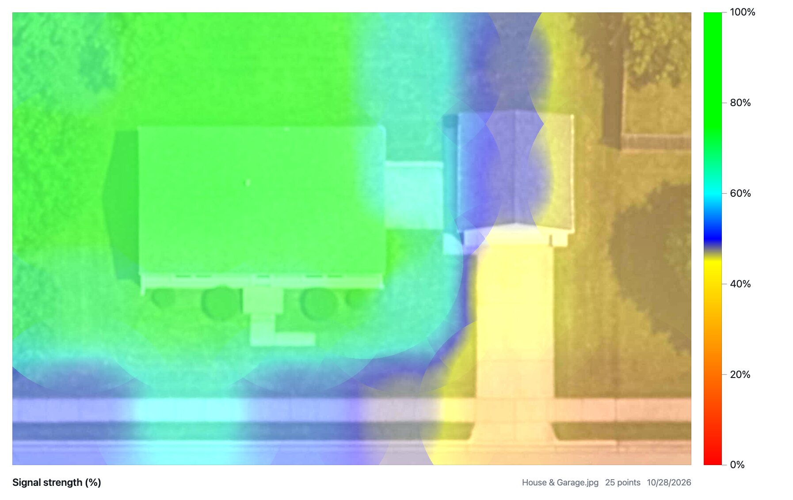

# Wi-Fi Heatmapper

**See where your Wi-Fi is weak.** Wi-Fi Heatmapper measures Wi-Fi signal
strength, and optionally throughput with iperf3, where you stand, and draws
heat maps of the results on your floor plan. Walk around with a laptop, click
where you are, and see which rooms need a mesh node or extender, and whether
a slow connection is really the Wi-Fi's fault.

Free and open source (MIT). Runs on **macOS, Windows and Linux**. Everything
stays on your computer: surveys are plain JSON files.

**Website and docs: <https://wifi-heatmapper.danielalder.cz>**



## Install

Download the app for your computer from the
[latest release](https://github.com/hnykda/wifi-heatmapper/releases/latest):
a `.dmg` for macOS, an installer for Windows, a `.deb` or AppImage for Linux.
On a Mac, Homebrew works too (and installs iperf3):

```bash
brew install --cask hnykda/tap/wifi-heatmapper
```

The apps are unsigned, so macOS and Windows warn you the first time.
[Installing the app](docs/guide/install.md) shows what to click on each
system, and [what has been tested](docs/guide/install.md#what-has-been-tested)
so far. To run it with Node.js instead:

```bash
git clone https://github.com/hnykda/wifi-heatmapper.git
cd wifi-heatmapper
npm install
npm run dev        # or npm run dev:mock for made-up measurements
```

## Use it with an AI agent (optional)

An optional [MCP](https://modelcontextprotocol.io) server lets an AI agent
such as Claude Code or Claude Desktop read your surveys, help you plan one,
and explain the results: dead zones, which access point covers which rooms,
and why throughput is slow. It talks to the running app on this computer
only; it can't take measurements (yet) or see your sudo password.

```bash
npm run mcp:build
claude mcp add wifi-heatmapper -- node "$PWD/dist/mcp/wifi-heatmapper-mcp.mjs"
```

The desktop app ships it too. Setup for other clients, the tools and the
limits are in [the MCP guide](docs/guide/mcp.md).

## Documentation

The guide lives in [`docs/guide`](docs/guide) and is published at
[wifi-heatmapper.danielalder.cz/docs](https://wifi-heatmapper.danielalder.cz/docs/getting-started).

- [Getting started](docs/guide/getting-started.md): install and your first survey
- [Installing the app](docs/guide/install.md): per system, first launch, data and log paths
- [Using the app](docs/guide/using-the-app.md): every tab and setting
- [Measuring speed with iperf3](docs/guide/throughput.md)
- [How it works](docs/guide/how-it-works.md): readings per system, signal percent vs dBm, the heat map
- [Running from source](docs/guide/run-from-source.md): Node.js, mock mode, Docker, logs
- [AI agents (MCP)](docs/guide/mcp.md): let Claude or another agent read and explain your surveys
- [FAQ](docs/guide/faq.md)
- [Changelog](CHANGELOG.md)

For AI assistants: [llms.txt](https://wifi-heatmapper.danielalder.cz/llms.txt)
indexes all of the above, and
[llms-full.txt](https://wifi-heatmapper.danielalder.cz/llms-full.txt) has it in
one file.


## Contributing

Pull requests are welcome. [CONTRIBUTING.md](CONTRIBUTING.md) has the setup,
the test suites and what a PR needs; [docs/dev](docs/dev) has the
[architecture](docs/dev/architecture.md) and the
[desktop app](docs/dev/desktop-app.md). Every PR needs evidence it was tested:
automated tests, or a screenshot and a note on which OS you tried it.

Found a bug? Open an [issue](https://github.com/hnykda/wifi-heatmapper/issues/new/choose)
with the details from the app's About dialog (the "i" button in the header).
Tried a desktop app? [Tell us how it went](https://github.com/hnykda/wifi-heatmapper/issues/new?template=desktop-app-report.md),
even if it just worked.

## History and credits

Inspired by [python-wifi-survey-heatmap](https://github.com/jantman/python-wifi-survey-heatmap).
@hnykda started this version to get heat maps on a Mac with a browser UI;
@richb-hanover built the four-tab interface and much of the platform support.
The heat map renderer uses WebGL inverse-distance weighting contributed in
[#35](https://github.com/hnykda/wifi-heatmapper/pull/35).

An early [screen recording](https://www.youtube.com/watch?v=pXlm-eWaJCs)
shows the original single-page version (with the opposite colour scheme).
